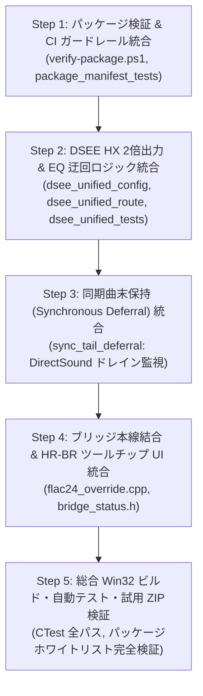

# DSEE HX 2倍出力を通常版へ統合するための差分棚卸し (Issue #53)

## 1. 概要と背景

本ドキュメントは、#21 の試用 ZIP に向けた事前準備として、通常版の基点ブランチ `dev/dsee-hx`（コミット `23c8725`）と実験・検証ブランチ `codex/dsee-hx-validation`（コミット `df1b712`）の差分を棚卸しし、以下の 3 つの主要機能を通常版へ安全に統合するための整理・計画書である。

1. **DSEE HX 2倍出力 (44.1kHz → 88.2kHz / 24bit, 48kHz → 96kHz / 24bit)**:
   - 全コーデック（FLAC, AAC, MP3, ALAC, WAV）を対象とした整数 2 倍オーバーサンプリングおよび 24bit 化。
2. **EQ無効または迂回 (`OmgEqxlFilter.ax` バイパス)**:
   - 24bit / ハイレゾレートを拒絶するイコライザフィルタを迂回し、DirectSound Renderer へ直結。
3. **同期曲末保持 (Synchronous Track Tail Retention / Pause Deferral)**:
   - 曲間・フォーマット変更時の早期 Pause/Stop を一時保留し、DirectSound レンダラーのバッファ再生が完了するまで待機して曲末途切れを防止。

### 前提条件と除外事項（Issue #53 要件）
- **4倍出力 (Family4x: 176.4k/192k) の除外**:
  - Windows DirectSound 共有ミキサーやダウンサンプラーの制約、176.4kHz の不安定要因を排除し、実機検証で安定実績のある 2 倍出力（88.2k / 96k）を標準とする。
- **非同期曲送り (Async Pause Deferral / Virtual Pause) の除外**:
  - マルチスレッド状態遷移や非同期シーク抑止（Issues #33〜#41）は今回の試用版では前提から外し、確実性の高い**同期ドレイン待機方式（#21 / #23 / #43 / #47）**に絞り込む。
- **適用ガバナンス**:
  - 通常版への反映は、#21 の実機回帰確認が完了した後とする。
  - 実音源、PCM、生ログ、ローカルパス、第三者バイナリの逆アセンブリは非公開を徹底する。

---

## 2. 両ブランチの構造と変更差分の比較

### 2.1 ブランチ系譜と実装配置の相違

| 項目 | 通常版基点: `dev/dsee-hx` (`23c8725`) | 実験側: `codex/dsee-hx-validation` (`df1b712`) |
|:---|:---|:---|
| **分岐元** | `ffced95`（#18 アイコン更新）以降、UI表示・初期DSEEを `src/` に直接実装 | `ffced95` より分岐後、実験コードを `experiments/` 配下に独立展開 |
| **DSEE HX 実装** | `src/bridge/shared_dsee.inl`, `src/bridge/shared_dsee_route.inl` | `experiments/dsee_unified/` (`dsee_unified_config.h`, `dsee_unified_route.h`, `dsee_unified_hooks.inl`) |
| **曲末保持実装** | 未実装（`shared_dsee.inl` での単純 Pause フックのみ） | `experiments/eos_transition/` (`eos_transition.h`, `eos_transition_hooks.inl`) |
| **UI・ステータス** | `src/bridge/bridge_status.h`（HR-BR ホバーツールチップ、再生情報 `publish`/`snapshot`）を完備 | 実験用簡易ステータス（詳細 UI 表示ロジック未マージ） |
| **パッケージ検証** | `build-windows.yml` 内の簡易インライン検証 | `tools/verify-package.ps1`, `tests/package_manifest_tests.cpp` による厳格なブラックリスト・PE 検証 (#32) |

---

### 2.2 機能別の詳細差分

#### (1) DSEE HX 2倍出力 (44.1k → 88.2k / 48k → 96k, 24bit)
- **`dev/dsee-hx` の実装**:
  - `OmgDseeHxFilter.ax` の slot 3（RVA `0x36CA`, TimeDateStamp `0x63EB12C1`）をフック。
  - `eligibleDsee` の判定が `inputRate == 44100 && inputBits == 16` に限定されており、48kHz 系および 24bit 入力を受け付けない。
  - AAC 以外は一律 176.4kHz（4倍）に設定（`adjusted.outputRate = c.format==3 ? 96000 : 176400`）。
  - フォーマット判定を `c.format` や `c.unknown` のマジックナンバー（例: AAC=3, ALAC/FLAC=101, MP3=2）に依存しており脆弱。
- **`codex/dsee-hx-validation` の実装**:
  - 同一の slot 3 をフック。
  - `isTargetInputRate`: 44.1kHz と 48kHz の双方を対象。
  - `isTargetInputBits`: 16bit と 24bit の双方を対象。
  - `HarmonizeMode::Family2x`（既定）:
    - 44.1kHz 系 $\rightarrow$ 88.2kHz / 24bit
    - 48kHz 系 $\rightarrow$ 96kHz / 24bit
  - 呼出元モジュールのアドレス（`_ReturnAddress()`）からコーデックを判定（`OpcFlac.dll`, `OpcMp4.dll`, `OpcWavEx.dll`, `OpcCd3.dll`/`OpcMp3.dll`）。
  - FLAC デコーダのビット深度（`getActiveDecoderBits()`）を追跡し、非 FLAC 再生時にはビット深度状態を初期化してコーデック間の汚染を完全に分離（#49）。
  - DSEE OFF（`mode == 0`）や 88.2kHz 以上のネイティブハイレゾは未変更でパススルー。

#### (2) EQ無効または迂回 (`applyEqBypass`)
- **`dev/dsee-hx` の実装**:
  - `src/bridge/shared_dsee_route.inl` 内の `prepareDirect`。
  - 固定の 3 エッジ（DSEE $\rightarrow$ FsConv $\rightarrow$ Eqxl $\rightarrow$ DSoundRender）を前提とした決め打ち接続。
  - `dseePcm` は 176.4kHz / 24bit のみを許容しており、88.2kHz / 96kHz で失敗。
  - `SeamlessFilter` が介在するグラフや FsConv が存在しないグラフで破綻する。
- **`codex/dsee-hx-validation` の実装**:
  - `experiments/dsee_unified/dsee_unified_route.h` 内の `applyEqBypass(IGraphBuilder*)`。
  - DirectShow フィルタグラフを走査し、`CLSID_DseeHxFilter`, `CLSID_SeamlessFilter`, `OmgEqxlFilter`, `CLSID_DSoundRender` を動的に検出。
  - **二重トポロジ対応**:
    - **Peer Code 1 (Direct Seamless)**: 96kHz / 24bit（48kHz 2倍出力）時、`SeamlessFilter` は 96kHz を通過できるため `SeamlessFilter` 出力 $\rightarrow$ `DirectSoundRender` を直結。
    - **Peer Code 2 (Direct DSEE)**: 88.2kHz / 24bit（44.1kHz 2倍出力）時、`SeamlessFilter` / `OmgFsConvFilter` が 88.2kHz を通過できないため、`OmgDseeHxFilter` 出力 $\rightarrow$ `DirectSoundRender` を直結（#46）。
  - グラフ状態管理: 再生・一時停止中の安全な切り替え（Stop $\rightarrow$ 配線変更 $\rightarrow$ Pause 復帰）、シーク位置（`IMediaSeeking`）の保存と復元、失敗時の自動ロールバック。

#### (3) 同期曲末保持 (Synchronous Track Tail Retention)
- **`dev/dsee-hx` の実装**:
  - 曲末保持機構が存在しない。フォーマット変更を伴う自動曲送り時に、次曲デコード準備失敗（`Open()`）に起因する予期せぬ `Pause()` / `Stop()` が先行曲の末尾を途切れさせる。
- **`codex/dsee-hx-validation` の実装**:
  - `IMediaControl::Pause` および `IMediaFilter::Pause` をフック。
  - 自動曲送り・フォーマット変更時の呼び出し（`isKnownCaller && pendingFormatChange`）を検知。
  - **同期ドレイン待機 (`deferFormatChangePause`)**:
    - メッセージループを回しながら、`IMediaSeeking` の現在位置と終了位置を照合。
    - DirectSound セカンダリバッファの再生状態（`DSBSTATUS_PLAYING`）をポーリング監視し、ハードウェア/レンダラーバッファ内の PCM が完全に吐き出されるまで Pause 実行を同期的に待機（#21 / #23 / #47）。
    - ドレイン完了時に下流イコライザ/レンダラーへ `EndOfStream` を正常送出。
    - 手動操作（手動シーク、手動停止、手動一時停止）の割り込み時は待機を即座に安全キャンセル。

#### (4) パッケージ検証と配布物整合性 (#32)
- **`dev/dsee-hx` の実装**:
  - CI スクリプト内でファイル名の一致のみを確認。
- **`codex/dsee-hx-validation` の実装**:
  - `tools/verify-package.ps1`:
    - 配布物ホワイトリスト（5 ファイル: `MC HiRes Bridge.exe`, `flac24_override.dll`, `README.md`, `LICENSE`, `MinHook.txt`）を厳格に検証。
    - ブラックリスト検出（診断・実験・テストバイナリ、`.pdb` 等の混入を即時検知）。
    - PE フォーマット検証（x86 32-bit `0x014C`、GUI/Console サブシステム整合性）。
    - 自動セルフテスト（`-SelfTest`）による検知ロジックの自己証明。
  - `tests/package_manifest_tests.cpp`:
    - CMake テストスイートに統合されたネイティブ検証ユニットテスト。

---

## 3. 競合箇所と影響範囲の確認

### 3.1 競合箇所の特定

1. **`src/bridge/flac24_override.cpp`**:
   - `dev/dsee-hx` は旧 `shared_dsee.inl` をインクルードし、HR-BR ホバーツールチップ更新ロジックを持つ。
   - `codex/dsee-hx-validation` は `#ifdef EXPERIMENT_DSEE_UNIFIED` / `#ifdef EXPERIMENT_EOS_TRANSITION` により実験モジュールを切り替える構成。
   - **解消方針**: 実験フラグを外し、DSEE 2倍出力と同期曲末保持の確定ロジックを通常版の本線コードとして `src/bridge/` に正式昇格する。UI 更新ロジック（`bridgeStatus::publish`）を維持・統合する。
2. **`src/bridge/bridge_status.h`**:
   - `dev/dsee-hx` に存在する `tooltipText()`, `formatText()`, `publish()`, `snapshot()` 等の UI 資産を完全に維持する。
   - DSEE 2倍出力による 88.2kHz / 96kHz がツールチップ上に正しく反映されるようフォーマット表示を統合する。
3. **同期曲末保持と非同期コードの分離**:
   - `codex/dsee-hx-validation` の `eos_transition_hooks.inl` には、今回除外対象とする非同期曲送り（`EXPERIMENT_ASYNC_VIRTUAL_PAUSE` 等、約 1,500 行）が混在している。
   - **解消方針**: 同期待機（`PauseMode::Defer` / `deferFormatChangePause`）の最小コアのみを抽出して統合し、非同期のワーカースレッドやシーク抑止ロジックは持ち込まない。

### 3.2 既存機能への影響確認

- **AAC / MP3 / ALAC への影響**:
  - 従来は 44.1kHz のみ、かつ 176.4kHz（AAC は 96kHz）への変則アップサンプリングだったが、44.1k $\rightarrow$ 88.2kHz / 48k $\rightarrow$ 96kHz の整数 2 倍に統一される。
  - #49 のデコーダビット深度分離により、直前の FLAC 24bit 再生状態が 16bit 圧縮音源へ持ち越される不具合が解消し、安定性が大幅に向上する。
- **DSEE OFF 時の原音経路への影響**:
  - DSEE OFF（`mode == 0`）時はフックが一切介入せず `originalDsee` へパススルーされるため、原音再生経路に影響を与えない。
- **96kHz / 192kHz 24bit FLAC 原音経路への影響**:
  - ハイレゾレート（$\ge 88.2\text{kHz}$）は DSEE 対象外として即座にパススルーされ、既存の FLAC 24bit 維持フック（`setterHook`）によりビットパーフェクト再生が維持される。
- **HR-BR 表示・ツールチップへの影響**:
  - 88.2kHz / 24bit（Peer Code 2）および 96kHz / 24bit（Peer Code 1）の出力時、`Route::Dsee` としてトレイアイコンおよびホバーツールチップに正確なレート・ビット深度が表示される。

---

## 4. 統合対象の一覧と根拠

| No | 統合対象 | 移行元 (`codex/dsee-hx-validation`) | 移行先 (`dev/dsee-hx`) | 根拠・目的 |
|:---:|:---|:---|:---|:---|
| **1** | パッケージ検証スクリプト | `tools/verify-package.ps1` | `tools/verify-package.ps1` | #32 成果の再利用。配布 ZIP から診断・実験バイナリを確実に除外し、PE 整合性を担保。 |
| **2** | パッケージマニフェストテスト | `tests/package_manifest_tests.cpp`, `tests/CMakeLists.txt` | `tests/package_manifest_tests.cpp`, `tests/CMakeLists.txt` | CMake CTest による配布物ルールの自動検証。 |
| **3** | GitHub Actions ワークフロー | `.github/workflows/build-windows.yml` | `.github/workflows/build-windows.yml` | CI パイプライン内でテスト実行、セルフテスト、SHA-256 チェックサム付き試用 ZIP 生成を自動化。 |
| **4** | DSEE HX 2倍設定 & コーデック判定 | `experiments/dsee_unified/dsee_unified_config.h` | `src/bridge/dsee_unified_config.h` | 44.1k $\rightarrow$ 88.2k / 48k $\rightarrow$ 96k (Family2x) 設定、呼出元モジュール判定、FLAC ビット深度分離 (#49)。 |
| **5** | DirectShow 動的配線 & EQ 迂回 | `experiments/dsee_unified/dsee_unified_route.h` | `src/bridge/dsee_unified_route.h` | フィルタ動的検出、EQxl 迂回、Peer Code 1 (96k Seamless直結) & Peer Code 2 (88.2k DSEE直結) のトポロジ切換。 |
| **6** | 同期曲末保持コア | `experiments/eos_transition/` (同期待機部分) | `src/bridge/sync_tail_deferral.h` | フォーマット変更時の早期 Pause を保留し、DirectSound バッファの曲末ドレイン完了まで同期待機 (#21, #23, #47)。※非同期コードは除外。 |
| **7** | ブリッジ本線フック & UI 統合 | `src/bridge/flac24_override.cpp`, `bridge_status.h` | `src/bridge/flac24_override.cpp`, `bridge_status.h` | DSEE 2倍フック、EQ迂回、同期曲末保持を本線 DLL に組み込み、HR-BR ツールチップへ再生情報を反映。 |
| **8** | DSEE 2倍自動テストスイート | `experiments/dsee_unified/tests/dsee_unified_tests.cpp` | `tests/dsee_unified_tests.cpp`, `tests/CMakeLists.txt` | コーデック分離、レート・ビット調和、EQ バイパス、ピン受入の全 15 テストをヘッドレスで自動回帰。 |

---

## 5. 推奨する統合順 (Step-by-Step)



1. **Step 1: パッケージ検証 & CI ガードレールの導入**:
   - まず `tools/verify-package.ps1` と `tests/package_manifest_tests.cpp` を導入し、CI ワークフローを更新。
   - 既存の `dev/dsee-hx` のクリーンな ZIP 生成とセルフテスト通過を確認（ベースラインの安全性確保）。
2. **Step 2: DSEE HX 2倍出力 & EQ 迂回ロジックの統合**:
   - `dsee_unified_config.h` と `dsee_unified_route.h` を `src/bridge/` に配置。
   - `tests/dsee_unified_tests.cpp` を追加し、全 15 ケースがヘッドレスでパスすることを確認。
3. **Step 3: 同期曲末保持の統合**:
   - `eos_transition` から同期待機（`deferFormatChangePause` + レンダラードレイン完了監視）の最小限のコアを抽出し、`sync_tail_deferral.h` として配置。
4. **Step 4: ブリッジ本線へのフック結合と UI ツールチップの連携**:
   - `flac24_override.cpp` 内で DSEE slot 3 フック、EQ 迂回、同期曲末保持を配線。
   - `bridge_status.h` の再生フォーマット・ルート情報（88.2kHz / 96kHz / 24bit）を更新。
5. **Step 5: 総合検証**:
   - 全自動テスト（`bridge_status_tests`, `package_manifest_tests`, `dsee_unified_tests`）を実行。
   - `./tools/verify-package.ps1 -CreateZip` により、診断・実験バイナリが一切含まれない試用 ZIP を生成・検証。

---

## 6. ビルド・自動テスト・試用 ZIP 確認手順

### 6.1 Win32 ローカルビルド
```powershell
# 1. CMake 構成 (Win32 Release)
cmake -S . -B build-Win32 -G "Visual Studio 17 2022" -A Win32

# 2. ビルド (ランチャー、DLL、および全テストターゲット)
cmake --build build-Win32 --config Release --target mc_hires_bridge bridge_status_tests package_manifest_tests dsee_unified_tests
```

### 6.2 ヘッドレス自動テストの実行
```powershell
# 出力モードパーサーおよび UI 表示テキストテスト
.\build-Win32\Release\bridge_status_tests.exe

# 配布物マニフェスト・PE 形式制約テスト
.\build-Win32\Release\package_manifest_tests.exe

# DSEE HX 2倍調和・全コーデック分離・EQ バイパステスト (全15テスト)
.\build-Win32\Release\dsee_unified_tests.exe
```

### 6.3 配布物パッケージングおよび混入防止検証 (#32)
```powershell
# パッケージ検証ツールのセルフテスト実行 (汚染検知ロジックの証明)
.\tools\verify-package.ps1 -SelfTest

# 試用 ZIP の生成とホワイトリスト・ブラックリスト検証
.\tools\verify-package.ps1 -BuildDir build-Win32 -CreateZip -OutputDir dist
```
- **確認項目**:
  - `dist/mc-hires-bridge-windows-x86.zip` が生成されること。
  - 同一ディレクトリに `mc-hires-bridge-windows-x86.zip.sha256` チェックサムが作成されること。
  - ZIP 内に以下の 5 ファイルのみが含まれ、診断ツール（`endpoint_loopback.exe`, `track_regression_tool.exe` 等）や実験 DLL が混入していないこと：
    1. `MC HiRes Bridge.exe`
    2. `flac24_override.dll`
    3. `README.md`
    4. `LICENSE`
    5. `licenses/MinHook.txt`

### 6.4 GitHub Actions での確認項目
- `dev/dsee-hx` または統合ブランチへプッシュ時：
  - ジョブ `Build Windows ZIP` が全ステップ Green で完了すること。
  - Artifacts に `mc-hires-bridge-windows-x86.zip` がアップロードされ、SHA-256 チェックサムとファイル一覧が Action ログに出力されること。
